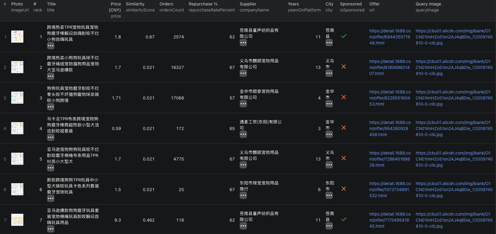

# How to Search 1688 by Image in Node.js

This example calls the [1688 Image Search Scraper](https://apify.com/piotrv1001/1688-image-search-scraper) through Apify's Node.js client. It uses an existing Actor; it does not implement image search or a scraper.



The screenshot shows seven visible matches from a separate run. The code below requests up to 30 matches from one example photo.

## What this example does

- Sends one public product photo to the Actor
- Requests up to 30 visually similar offers for that photo
- Waits for the run to finish
- Fetches and prints the resulting dataset

## Prerequisites

Node.js, an Apify account, and an Apify API token.

## Installation

```bash
npm install
```

## Environment setup

Copy `.env.example` to `.env` and replace the sample token with your Apify API token.

## Usage

```bash
npm start
```

Replace the example image URL with your own public product photo when you are ready. `maxResultsPerImage` applies to each input photo. Prices are in CNY; image matches do not include MOQ or quantity-price tiers.

## Code example

```js
import { ApifyClient } from 'apify-client';
import 'dotenv/config';

// Initialize the ApifyClient with your Apify API token
// Set APIFY_TOKEN in your .env file (copy .env.example to get started)
const client = new ApifyClient({
    token: process.env.APIFY_TOKEN,
});

// Prepare Actor input
const input = {
    imageUrls: ['https://cbu01.alicdn.com/img/ibank/O1CN01ImHZo51sn2AJ4qBDw_!!2009745810-0-cib.jpg'],
    maxResultsPerImage: 30,
    excludeSponsored: false,
};

// Run the Actor and wait for it to finish
const run = await client.actor("piotrv1001/1688-image-search-scraper").call(input);

// Fetch and print Actor results from the run's dataset (if any)
console.log('Results from dataset');
console.log(`💾 Check your data here: https://console.apify.com/storage/datasets/${run.defaultDatasetId}`);
const { items } = await client.dataset(run.defaultDatasetId).listItems();
items.forEach((item) => {
    console.dir(item);
});

// 📚 Want to learn more 📖? Go to → https://docs.apify.com/api/client/js/docs
```

## Example output

`sample-output.json` is **illustrative**, not a captured run. Result fields can include `offerId`, `url`, `price`, `currency`, `similarityScore`, `ordersCount`, `repurchaseRatePercent`, `companyName`, `city`, and `isSponsored`. Error rows instead carry a `status` such as `image_error` or `no_matches`.

## Use cases

- Find 1688 offers that resemble an existing product photo
- Build a shortlist of suppliers for closer checks
- Separate sponsored placements from organic matches
- Compare visual matches before checking MOQ and order terms

## Try the actor on Apify

**[Open the 1688 Image Search Scraper on Apify](https://apify.com/piotrv1001/1688-image-search-scraper)**

## Related resources

- [How to Search 1688 by Image and Shortlist Suppliers](https://www.falconscrape.com/blog/how-to-search-1688-by-image)

## License

MIT
